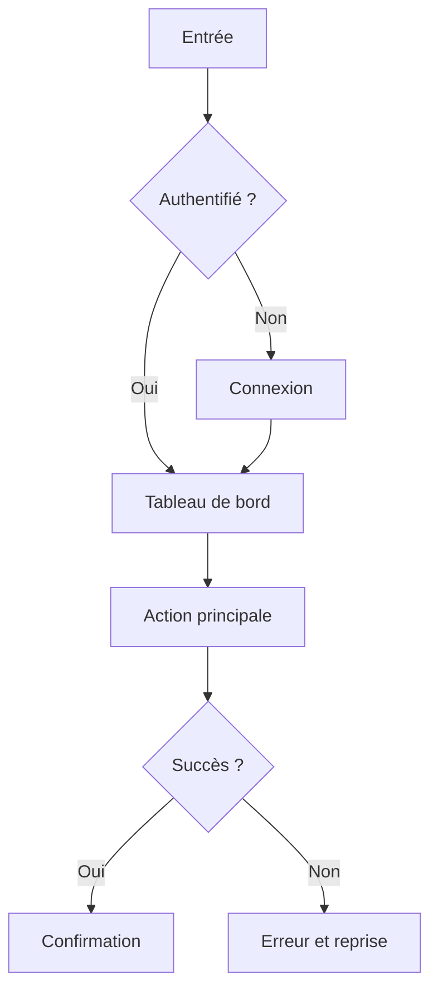

# APP FLOW — Parcours utilisateurs
**Responsable :** Product + UX · **Validation :** CTO

## Acteurs
| Rôle | Objectif | Permissions |
|---|---|---|
| [rôle] | [objectif] | [permissions] |

## Parcours général

## Fiche FLOW-001
- Déclencheur : [action]
- Préconditions : [état]
- Étapes : [liste]
- Variantes : [cas]
- Erreurs et reprise : [cas]
- Résultat attendu : [sortie]
- Exigences PRD : [IDs]

## Écrans
| ID | Écran | Rôle | Actions | États |
|---|---|---|---|---|
| SCR-001 | [nom] | [rôle] | [actions] | vide/chargement/erreur/succès |

## Validation
- [ ] Parcours P0 couverts
- [ ] Erreurs et retours arrière documentés
- [ ] Session expirée, hors ligne, droits insuffisants traités
- [ ] CTO valide
